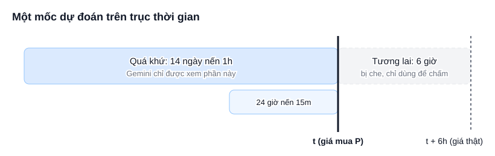
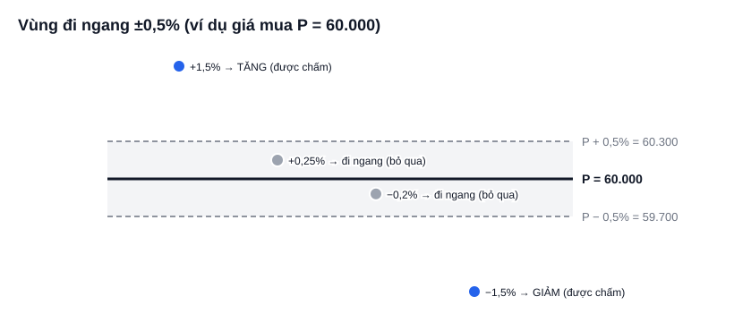
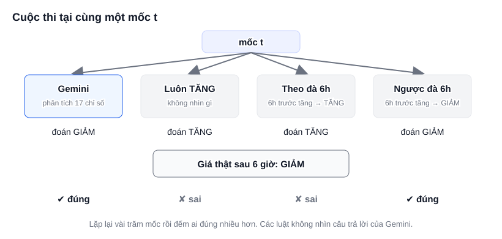
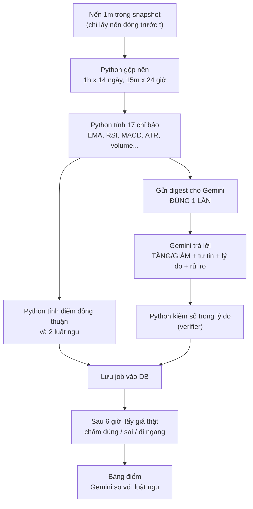
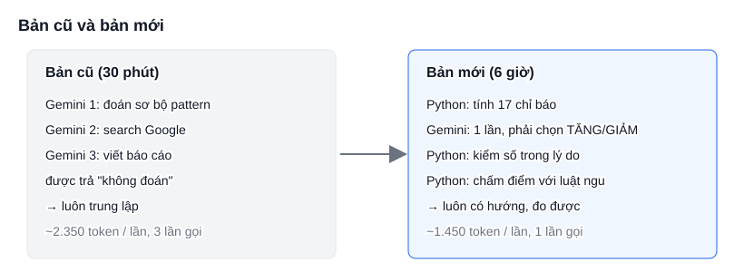
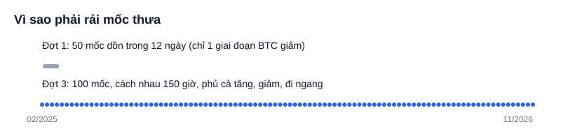
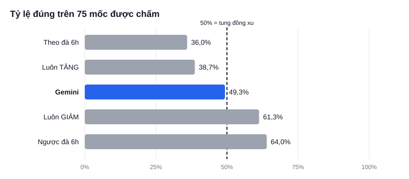
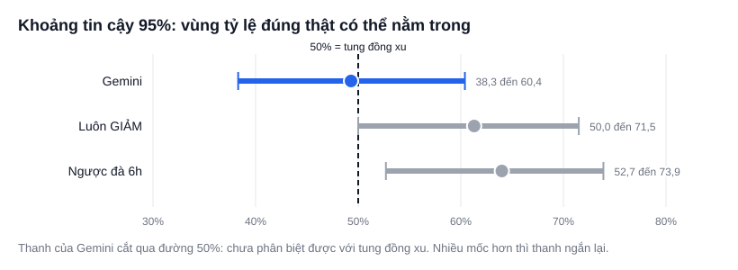
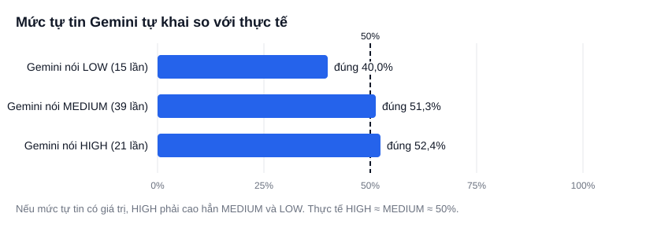

# Báo cáo kiểm thử: Gemini dự đoán xu hướng BTC 6 giờ tới

Ngày: 2026-11-22 · Người thực hiện: Lead (Claude) điều phối 2 thợ omp và command-code · Trạng thái: đã chạy thật, có số liệu

> **Đọc nhanh (TL;DR).** Gemini 2.5 Flash đoán BTC sau 6 giờ sẽ TĂNG hay GIẢM. Trên 75 lần đoán được chấm, Gemini đúng **49,3%**, tức **ngang tung đồng xu**. Nó còn thua những luật rất đơn giản như "luôn đoán GIẢM" trên cùng các lần đó. Mức tự tin (LOW/MEDIUM/HIGH) Gemini tự đưa ra gần như không giúp phân biệt lúc đúng và lúc sai. Mẫu còn nhỏ nên chưa phải kết luận cuối cùng, nhưng chưa có dấu hiệu Gemini giỏi hơn may rủi.

---

## 1. Câu hỏi đang trả lời

Tại một thời điểm `t`, cho Gemini xem dữ liệu kỹ thuật của BTCUSDT (chỉ dữ liệu **trước** `t`), hỏi:

> "6 giờ nữa giá sẽ **cao hơn** hay **thấp hơn** giá mua hiện tại?"

Sau đó chờ 6 giờ (trong dữ liệu quá khứ), xem giá thật để chấm đúng/sai, rồi so với vài "luật ngu" để biết Gemini có thật sự giỏi không.

## 2. Từ khoá (đọc trước nếu là người mới)

| Từ khoá | Nghĩa dễ hiểu |
|---|---|
| **BTCUSDT** | Cặp Bitcoin tính bằng đồng USDT (gần như bằng USD) trên sàn Binance. |
| **Nến (candle) 1m / 15m / 1h** | Một "ô" giá trong 1 phút / 15 phút / 1 giờ: giá mở, cao nhất, thấp nhất, đóng, khối lượng. |
| **Snapshot** | Một file lưu sẵn toàn bộ nến trong một khoảng thời gian, không đổi sau khi tạo. Bản dùng ở đây: nến 1m từ 01/02/2025 đến 22/11/2026, 949.380 nến. |
| **Mốc `t`** | Thời điểm giả sử ta đứng đó và dự đoán. |
| **Horizon (chân trời) 6h** | Dự đoán cho 6 giờ sau `t`. |
| **Giá mua P** | Giá đóng cửa của nến kết thúc ngay tại `t`. Mọi so sánh lên/xuống tính so với P. |
| **Lookback (nhìn lại) 14 ngày** | Lượng lịch sử trước `t` dùng để tính chỉ báo. |
| **Lookahead / nhìn trộm tương lai** | Lỗi dùng dữ liệu sau `t` khi dự đoán. Hệ thống chặn: chỉ nến đóng trước `t` mới được dùng. |
| **Chỉ báo kỹ thuật** | Con số tính từ giá: EMA (đường trung bình), RSI (sức mạnh tăng/giảm, 0 đến 100, 50 là trung tính), MACD (động lượng), ATR (độ biến động). |
| **Digest** | Bản tóm tắt khoảng 17 chỉ báo do Python tính, mỗi chỉ báo có mã `feature_id` (vd `1h_rsi14`). Đây là thứ duy nhất Gemini được xem. |
| **Điểm đồng thuận (agreement score)** | Python đếm bao nhiêu chỉ báo nghiêng TĂNG, bao nhiêu nghiêng GIẢM. Số thật, không phải Gemini tự nói. |
| **Đi ngang (FLAT)** | Sau 6 giờ giá lệch khỏi P **dưới 0,5%**. Coi là nhiễu, không chấm đúng/sai. |
| **Baseline / luật ngu** | Cách đoán cực đơn giản để làm thước đo đáy. Gemini phải thắng chúng mới có giá trị. |
| **Luôn TĂNG / Luôn GIẢM** | Không nhìn gì, lần nào cũng đoán TĂNG (hoặc GIẢM). |
| **Theo đà 6h** | 6 giờ trước giá tăng thì đoán tăng tiếp, giảm thì đoán giảm tiếp. |
| **Ngược đà 6h** | Ngược lại với "theo đà": vừa tăng thì đoán giảm, vừa giảm thì đoán tăng. |
| **Mức tự tin (LOW / MEDIUM / HIGH)** | Gemini tự đánh giá độ chắc chắn. Chưa được kiểm chứng. |
| **Khoảng tin cậy 95% (Wilson)** | Vùng mà tỷ lệ đúng "thật" nhiều khả năng nằm trong đó. Khoảng càng rộng, kết quả càng chưa chắc. Nếu khoảng có chứa 50% thì chưa phân biệt được với tung đồng xu. |
| **Batch** | Chạy hàng loạt nhiều mốc tự động bằng lệnh `shootingstar forecast-batch`. |
| **Dry-run** | Chạy thử không gọi Gemini, chỉ tính các luật ngu (miễn phí). |
| **Knowledge cutoff** | Thời điểm cuối cùng của dữ liệu Gemini được huấn luyện: gemini-2.5-flash là 01/2025. Mốc trước đó Gemini có thể "nhớ" giá thật nên kết quả không công bằng. Toàn bộ mốc trong báo cáo này **sau** 02/2025. |
| **Data snooping** | Thử nhiều luật rồi chọn luật thắng trên chính dữ liệu đó, dễ ra kết quả ảo. |
| **Verifier (bộ kiểm tra lý do)** | Python kiểm mọi con số Gemini trích trong lời giải thích có khớp digest không. |

### Hình 1. Một mốc dự đoán trên trục thời gian



<details><summary>Bản vẽ bằng chữ</summary>

```
   QUÁ KHỨ (được nhìn)                         TƯƠNG LAI (bị che)
◄──────────── 14 ngày nến 1h ────────────►│◄──────── 6 giờ ────────►
                    ◄──── 24 giờ nến 15m ──►│
                                           │
                                           t                     t + 6h
                                     (giá mua P)           (giá thật để chấm)
                                           │
              Gemini CHỈ thấy phần này ◄───┘   Phần này dùng để chấm điểm,
                                                Gemini không bao giờ thấy
```

</details>

### Hình 2. Vùng đi ngang ±0,5% (ví dụ P = 60.000)



<details><summary>Bản vẽ bằng chữ</summary>

```
 giá sau 6h
   60.900 ┤  ●  lệch +1,5%  → TĂNG     (chấm: ai đoán TĂNG thì đúng)
          │
   60.300 ┼──────────────────────────── P + 0,5%
   60.150 ┤  ●  lệch +0,25% → ĐI NGANG  (bỏ qua, không chấm)
   60.000 ┤━━━━━━━━━━━━━━━━━━━━━━━━━━━━ P (giá mua)
   59.880 ┤  ●  lệch −0,2%  → ĐI NGANG  (bỏ qua, không chấm)
   59.700 ┼──────────────────────────── P − 0,5%
          │
   59.100 ┤  ●  lệch −1,5%  → GIẢM     (chấm: ai đoán GIẢM thì đúng)
```

</details>

### Hình 3. Cuộc thi: Gemini đấu với các luật ngu



<details><summary>Bản vẽ bằng chữ</summary>

```
                         cùng một mốc t
        ┌──────────────┬───────┴──────┬──────────────┐
        ▼              ▼              ▼              ▼
   ┌─────────┐   ┌──────────┐   ┌──────────┐   ┌──────────┐
   │ Gemini  │   │ Luôn TĂNG│   │ Theo đà  │   │ Ngược đà │
   │phân tích│   │ không    │   │ 6h trước │   │ 6h trước │
   │17 chỉ số│   │ nhìn gì  │   │ tăng→TĂNG│   │ tăng→GIẢM│
   └────┬────┘   └────┬─────┘   └────┬─────┘   └────┬─────┘
        │ GIẢM        │ TĂNG         │ TĂNG         │ GIẢM
        └─────────────┴──────┬───────┴──────────────┘
                             ▼
                  giá thật sau 6 giờ: GIẢM
                             ▼
              Gemini ✔   Luôn TĂNG ✘   Theo đà ✘   Ngược đà ✔
```

</details>

Các luật ngu chạy **độc lập**, không nhìn câu trả lời của Gemini. Lặp lại vài trăm mốc rồi đếm ai đúng nhiều hơn.

## 3. Cách hệ thống chạy một lần dự đoán

### Hình 4. Luồng xử lý một mốc



Bản chữ (nếu trình xem không vẽ được Mermaid):

```
Nến 1m (chỉ trước t)
   → Python gộp thành nến 1h (14 ngày) và 15m (24 giờ)
   → Python tính 17 chỉ báo + điểm đồng thuận + 2 luật ngu
   → Gửi digest cho Gemini, gọi ĐÚNG 1 LẦN
   → Gemini trả: TĂNG/GIẢM + mức tự tin + lý do (trỏ mã chỉ báo) + rủi ro
   → Python kiểm con số trong lý do
   → Lưu tất cả vào DB (job), chấm điểm khi có giá sau 6 giờ
```

### Hình 5. So sánh bản cũ và bản mới



<details><summary>Bản vẽ bằng chữ</summary>

```
BẢN CŨ (30 phút, 3 lần gọi)                 BẢN MỚI (6 giờ, 1 lần gọi)
┌──────────────────────────────┐             ┌──────────────────────────────┐
│ Gemini 1: đoán sơ bộ pattern │             │ Python: tính 17 chỉ báo      │
│ Gemini 2: search Google      │   ──────►   │ Gemini: 1 lần, phải chọn     │
│ Gemini 3: viết báo cáo       │             │         TĂNG hoặc GIẢM       │
│ được trả "không đoán"        │             │ Python: kiểm số, chấm điểm   │
│ → luôn trung lập             │             │ → luôn có hướng, đo được     │
│ ~2.350 token / lần           │             │ ~1.450 token / lần           │
└──────────────────────────────┘             └──────────────────────────────┘
```

</details>

- Mỗi mốc là **1 lần gọi Gemini riêng**. Gemini không nhớ gì giữa các lần, không thấy kết quả mốc trước.
- Gemini **không được phép** trả "không đoán" (ABSTAIN). Bản cũ cho phép nên nó luôn né, đó là lý do làm lại.
- Không search Google, không đọc tin tức.

## 4. Đã kiểm thử những gì

### 4.1 Kiểm thử phần mềm (code có chạy đúng không)

| Hạng mục | Cách kiểm | Kết quả |
|---|---|---|
| Test backend (`pytest`) | Chạy toàn bộ trên DB chính; đếm số dòng DB trước/sau để chắc test không để rác | 143 passed; số dòng snapshot/lượt tải không đổi |
| Chỉ báo kỹ thuật | So với giá trị tính tay (EMA, RSI, MACD, ATR) | Khớp |
| Chống nhìn trộm tương lai | Thêm nến sau `t` rồi tính lại digest | Digest không đổi |
| Chấm đi ngang 0,5% | +1,5% → TĂNG, −1,2% → GIẢM, +0,3% → đi ngang, thiếu nến → không chấm được | Đúng |
| Cờ "có thể nhớ giá" | Mốc 12/2024 bị gắn cờ, 03/2025 không | Đúng |
| Chỉ gọi Gemini 1 lần / job | Đếm lượt gọi trong test và trên job thật | 1 lần; khoảng 1.450 token/job (bản cũ 3 lần) |
| Bộ kiểm tra lý do | Chạy lại trên 107 job thật; cài thử 3 con số bịa (`99.12`, `12.3456`, `77.7%`) | 107/107 hợp lệ; cả 3 số bịa bị bắt |
| Frontend | `npm run typecheck`, `npm run build`, Playwright e2e | Xanh; Playwright 14/14 |
| Bảng điểm API | Gọi có và không có admin key | 200 có key, 403 không key |
| Dry-run batch | Chạy 2.580 mốc, đếm job trong DB trước/sau | 0 dòng mới (200 mốc chạy 16 giây) |

### 4.2 Kiểm thử nghiên cứu (Gemini có đoán giỏi không)

**Dữ liệu:** snapshot nến 1m BTCUSDT, 01/02/2025 đến 22/11/2026 (sau knowledge cutoff của Gemini).

**Bước 1. Đo luật ngu trên toàn bộ dữ liệu (miễn phí, 2.580 mốc cách nhau 6 giờ):**

| Chỉ số | Giá trị |
|---|---|
| Mốc đi ngang (lệch < 0,5%) | 1.307 (50,7%) |
| Mốc được chấm | 1.273 |
| Biến động 6 giờ trung vị | 0,49% |
| Luôn TĂNG | 49,88% |
| Luôn GIẢM | 50,12% |
| Theo đà 6h | 46,50% |
| Ngược đà 6h | 53,50% (CI khoảng 50,8 đến 56,2) |

Ý nghĩa: hướng đi BTC sau 6 giờ gần như ngẫu nhiên. "Ngược đà" nhỉnh hơn một chút nhưng được tìm ra **sau khi nhìn dữ liệu** (data snooping) và chưa trừ phí giao dịch khoảng 0,2%/lượt, nên chưa đáng tin.

**Bước 2. Chạy Gemini thật (3 đợt):**

| Đợt | Cách chọn mốc | Số mốc | Ghi chú |
|---|---|---|---|
| 1 | Liền nhau, cách 6 giờ | 50 | Chỉ phủ 14 đến 27/02/2025, giai đoạn BTC giảm |
| 2 | Cách 26 giờ | 4 | Dừng sớm theo yêu cầu user |
| 3 | Cách 150 giờ, rải đều 21 tháng | 100 | Chạy khoảng 25 phút, không hết quota |
| Khác | Job thử tay khi kiểm từng phase | 4 | |
| **Tổng** | | **158 job READY** | 81 đi ngang, **75 được chấm** |

### Hình 6. Vì sao phải rải mốc thưa (đợt 1 và đợt 3)



<details><summary>Bản vẽ bằng chữ</summary>

```
              02/2025                                              11/2026
Đợt 1:        ●●●●●●●●●  (50 mốc dồn trong 12 ngày, toàn giai đoạn BTC giảm)
              ↑ chỉ thấy 1 kiểu thị trường → kết quả lệch

Đợt 3:        ●     ●     ●     ●     ●     ●     ●     ●     ●     ●  ...
              (100 mốc, cách nhau 150 giờ ≈ 6 ngày, phủ cả tăng, giảm, đi ngang)
```

</details>

Chi phí: khoảng 1.450 token mỗi job; đợt 1 tổng 76.532 token. Không gặp lỗi hết quota (429) với 10 key.

**Bước 3. Kết quả trên 75 mốc được chấm (cùng một tập mốc cho mọi người đoán):**

| Người đoán | Đúng | Tỷ lệ | Khoảng tin cậy 95% |
|---|---|---|---|
| **Gemini** | 37/75 | **49,3%** | 38,3% đến 60,4% |
| Luôn TĂNG | 29/75 | 38,7% | 28,5% đến 50,0% |
| Luôn GIẢM | 46/75 | 61,3% | 50,0% đến 71,5% |
| Theo đà 6h | 27/75 | 36,0% | 26,1% đến 47,3% |
| Ngược đà 6h | 48/75 | 64,0% | 52,7% đến 73,9% |

**Theo mức tự tin của Gemini:**

| Gemini nói | Đúng | Tỷ lệ |
|---|---|---|
| LOW | 6/15 | 40,0% |
| MEDIUM | 20/39 | 51,3% |
| HIGH | 11/21 | 52,4% |

Gemini đoán GIẢM 64% số lần.

### Hình 7. Tỷ lệ đúng trên 75 mốc (mỗi ô = 2,5%)



<details><summary>Bản vẽ bằng chữ</summary>

```
                   0%       25%       50%       75%      100%
                   |         |         |         |         |
Theo đà 6h   36,0% ██████████████▍     ┊
Luôn TĂNG    38,7% ███████████████▍    ┊
Gemini       49,3% ███████████████████▋┊   ← ngang tung đồng xu
Luôn GIẢM    61,3% ████████████████████████▌
Ngược đà 6h  64,0% █████████████████████████▌
                                       ┊
                        đường 50% = tung đồng xu
```

</details>

### Hình 8. Khoảng tin cậy 95%: vì sao 49,3% vẫn là "chưa biết"



<details><summary>Bản vẽ bằng chữ</summary>

```
             30%       40%       50%       60%       70%       80%
             |         |         |         |         |         |
Gemini               [==========●==========]                     38,3 → 60,4
Luôn GIẢM                        [==========●==========]         50,0 → 71,5
Ngược đà 6h                      ┊  [==========●=========]       52,7 → 73,9
                                 ┊
                       50% = tung đồng xu
```

</details>

- Dấu `●` là tỷ lệ đo được; thanh `[====]` là vùng tỷ lệ thật có thể nằm trong.
- Thanh của Gemini **cắt qua đường 50%**: không phân biệt được với tung đồng xu.
- Muốn thanh ngắn lại (kết luận chắc hơn) thì cần nhiều mốc hơn: 75 mốc cho thanh rộng khoảng ±11%, khoảng 300 mốc cho khoảng ±5,6%.

### Hình 9. Mức tự tin có giúp gì không?



<details><summary>Bản vẽ bằng chữ</summary>

```
           Gemini nói      Thực tế đúng
           LOW      (15)   ████████            40,0%
           MEDIUM   (39)   ██████████▎         51,3%
           HIGH     (21)   ██████████▍         52,4%
                                     ┊
                                    50%
Nếu mức tự tin có giá trị: HIGH phải cao hẳn MEDIUM, MEDIUM cao hẳn LOW.
Thực tế: HIGH ≈ MEDIUM ≈ tung đồng xu → nhãn tự tin chưa dùng được.
```

</details>

Các con số trên được tính lại **độc lập** từ file nến gốc (không qua code chấm điểm của hệ thống) và khớp hoàn toàn với bảng điểm API.

## 5. Đọc kết quả

1. **Gemini ngang tung đồng xu.** 49,3%, khoảng tin cậy chứa 50%.
2. **Gemini thua luật ngu trên cùng tập mốc.** "Luôn GIẢM" 61,3%, "ngược đà" 64,0%. Hai luật này cao ở đây chủ yếu vì mẫu nhỏ: trên toàn kỳ 1.273 mốc chúng chỉ 50,1% và 53,5%. Nhưng Gemini vẫn không vượt được.
3. **Mức tự tin không có giá trị phân biệt.** HIGH 52% gần bằng MEDIUM 51%. Đúng với nghiên cứu: LLM tự khai độ tin thường quá tự tin (Xiong et al., ICLR 2024).
4. **Gemini nghiêng về theo xu hướng đang có** (đoán GIẢM 64%) chứ không cho thấy phân tích vượt trội.
5. **Giới hạn:** 75 mốc còn ít (sai số khoảng ±11%); chỉ 1 cặp coin; chỉ 1 phiên bản prompt; chưa trừ phí giao dịch; chưa thử lookback 7 hoặc 30 ngày.

## 6. Lỗi và vấn đề phát hiện trong quá trình kiểm thử

| Vấn đề | Mức độ | Xử lý |
|---|---|---|
| Bộ kiểm tra lý do báo nhầm: coi "1 giờ", "RSI 14", "EMA 20 và 50", "giảm 0,6073%" (bỏ dấu âm), số cắt bớt chữ số, tỷ lệ viết thành %, giá mua là số bịa | Trung bình (job nào cũng bị đánh "không hợp lệ") | Đã sửa qua 3 vòng; 107/107 job thật hợp lệ, số bịa vẫn bị bắt |
| Lệnh batch khi chạy lại bỏ qua cả mốc lỗi, mốc hết quota mất vĩnh viễn | Trung bình | Đã sửa: mốc FAILED được thử lại |
| Tham số lookback gần như không ảnh hưởng chỉ báo | Trung bình | Đã thêm chỉ báo theo đúng N ngày |
| Mô phỏng vào lệnh 30 phút nạp toàn bộ 949.380 nến (nạp riêng mất 5,2 giây, cả quy trình chậm hơn nhiều) | Cao với snapshot dài | Đang sửa: chỉ nạp cửa sổ cần (0,78 giây) |
| Giao diện ghi "Chưa có dữ liệu" khi thật ra chỉ là chưa mở kết quả | Thấp | Đang sửa chữ hiển thị |
| Dòng tổng kết của lệnh batch đếm "scored" trên mọi job cũ, dễ hiểu nhầm | Thấp | Ghi nhận |
| Next.js 16.4.0 có lỗ hổng bảo mật mức critical (npm audit) | Cao | Chưa nâng; cần lên 16.4.5 trở lên, chờ user quyết |
| `replay.spec.ts` lệch 1 ms ở mốc cuối khi dùng snapshot dài | Thấp | Chưa điều tra |

## 7. Đề xuất bước tiếp theo

Xem chi tiết các hướng trong [docs/forecast-strategy-options.md](../../forecast-strategy-options.md).

1. Nếu muốn kết luận chắc: chạy thêm khoảng 200 mốc rải đều (dùng `--step-hours` lớn), mục tiêu khoảng 300 mốc được chấm.
2. Thêm "luôn GIẢM" và "ngược đà 6h" vào bảng điểm chính thức (hiện chỉ tính tay trong báo cáo).
3. Thêm điểm phụ "lời/lỗ nếu làm theo, sau phí 0,2%".
4. Cân nhắc đổi vai trò Gemini: chỉ giải thích (hướng B), hoặc đổi câu hỏi sang dự đoán độ biến động (hướng F).

## 8. Cách tự chạy lại

Từ thư mục `backend/`, sau khi nạp `.env`:

```powershell
# Xem các snapshot
.\.venv\Scripts\shootingstar.exe list-snapshots

# Thử miễn phí: chỉ tính luật ngu, không gọi Gemini, không ghi DB
.\.venv\Scripts\shootingstar.exe forecast-batch --snapshot <snapshot-id> --dry-run --limit 3000

# Gọi Gemini thật (tốn quota), rải mốc thưa
.\.venv\Scripts\shootingstar.exe forecast-batch --snapshot <snapshot-id> --step-hours 150 --limit 100
```

Chạy lại cùng lệnh sẽ bỏ qua mốc đã xong và thử lại mốc lỗi. Bảng điểm xem trên trang báo cáo hoặc API `GET /external-analysis/scoreboard?snapshot_id=...` (cần admin key).

## 9. Nguồn tham khảo

- Hewamalage, Ackermann, Bergmeir, *Forecast Evaluation for Data Scientists: Common Pitfalls and Best Practices*: https://arxiv.org/pdf/2203.10716 (bắt buộc so với cách dự báo đơn giản)
- Xiong et al., *Can LLMs Express Their Uncertainty?*, ICLR 2024: https://arxiv.org/abs/2306.13063 (LLM tự khai độ tin quá mức)
- Tan et al., *Are Language Models Actually Useful for Time Series Forecasting?*, NeurIPS 2024: https://arxiv.org/abs/2406.16964 (phạm vi: mô hình gắn LLM, không phải prompt đọc chỉ số)
- Wei 2024, IJFE: https://onlinelibrary.wiley.com/doi/full/10.1002/ijfe.2863 (phân tích kỹ thuật crypto sau kiểm data snooping không có lời thật)
- Google, model card gemini-2.5-flash (knowledge cutoff 01/2025): https://ai.google.dev/gemini-api/docs/models/gemini-2.5-flash
- Tang & Zhu, *The Memorization Problem*: https://arxiv.org/html/2504.14765v2 (dặn model "đừng dùng kiến thức sau mốc" không ngăn được việc nhớ)

## Câu hỏi mở

- Có chạy thêm khoảng 200 mốc để thu hẹp sai số không?
- Có thêm "luôn GIẢM", "ngược đà" và điểm lời/lỗ sau phí vào bảng điểm chính thức không?
- Có nâng Next.js lên 16.4.5 trở lên ngay không?
