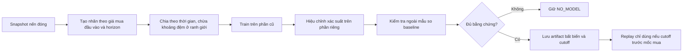

# Thiết kế tự huấn luyện model — lưu tham khảo, không triển khai lúc này

**Trạng thái:** Để nghiên cứu sau. Thiết kế này **không phải** chức năng đã có hay lựa chọn hiện tại cho Replay. Xem [Phase 02 hiện hành](plans/261009-historical-replay-research/phase-02-model-window-research.md) về các gate chưa đạt; hướng đang ưu tiên nghiên cứu: [API model ngoài](external-model-forecast-design.md).

## Ý nghĩa

Người dùng chọn thời điểm `t`, giá mua giả định `P`, và khoảng dự báo `h` (30 phút tới 24 giờ). Model phải học câu hỏi **giá ở `t+h` cao hay thấp hơn `P`**, không dùng nhãn giá đóng nến so giá đóng nến như thí nghiệm 30m hiện có. Không cần train mỗi lần click: huấn luyện theo đợt, lưu phiên bản bất biến; các lượt dự báo chỉ sử dụng phiên bản đã kiểm tra.

## Sơ đồ đơn giản

- **Train:** phần lịch sử cũ để model học. **Calibration:** phần riêng để đo/chỉnh cách diễn giải xác suất. **Test ngoài mẫu:** phần chưa dùng để train/chọn model, chỉ để đánh giá.
- **Khoảng đệm / purge:** bỏ các ví dụ có kết quả tương lai vắt qua ranh giới giữa hai phần; tránh vô tình biết đáp án kiểm tra.
- **Cutoff:** thời điểm cuối cùng mà dữ liệu hoặc lựa chọn model có thể ảnh hưởng đến dự báo. Với job replay tại `t`, cutoff phải trước `t`; mọi nến đầu vào có `available_at <= t`.
- Kết quả ngoài mẫu **không được dùng để chọn lại model rồi tuyên bố thành công trên chính tập đó**.

## Thực trạng (2026-10-10)

`shootingstar run-experiment --snapshot ...` hiện huấn luyện nhãn close-to-close 30m trong `backend/shootingstar/application/experiment.py`, xuất artifact và báo cáo; **không** tạo model đủ điều kiện dự báo theo `P` tùy ý. `backend/shootingstar/application/replay.py` vẫn trả `NO_MODEL` ngay cả khi manifest cũ có vẻ hợp lệ. Chưa có bước tự động “train xong → gắn winner → mở khóa Replay”. Không có bằng chứng model tự train thắng baseline cho BTC Spot 1m/5m ở các horizon được chọn.

## Nếu quay lại hướng này

1. Chốt quy tắc nến đóng, gap, giá mua giả định và nến chấm kết quả tại `t+h`.
2. Tạo feature giá mua và nhãn theo `P`; split train/calibration/validation/test theo thời gian, purge theo horizon và latency.
3. Đánh giá từng horizon riêng, công bố cả kết quả thua baseline/không đủ dữ liệu, kiểm tra calibration và chất lượng nến.
4. Lưu artifact/metadata nguồn snapshot hash, nhãn, phiên bản, mọi cutoff, horizon, tiêu chí chọn; không cập nhật artifact cũ tại chỗ.
5. Nối Replay chỉ sau kiểm tra không nhìn trước; nếu chưa đạt thì vẫn `NO_MODEL`. Nút UP/DOWN của người dùng không phải nhãn train.

**Không cam kết:** train càng nhiều càng tốt; không có con số độ chính xác, lợi nhuận, hay ngày hoàn tất khi chưa kiểm định thực tế. Thiết kế này được cất lại để người dùng nghiên cứu sau, không cản việc nghiên cứu API model ngoài theo hướng thử nghiệm tách biệt.
