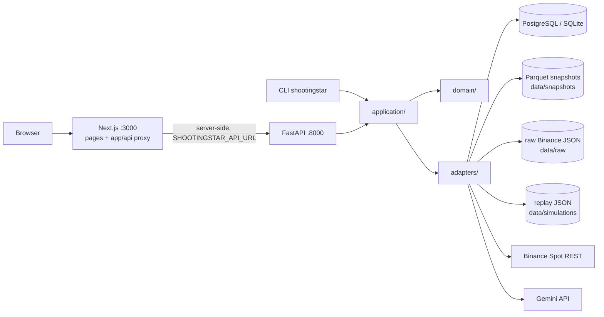

# ShootingStar System Design Reference

Bản đồ kiến trúc của ShootingStar: backend có tầng gì, luồng nào, API nào, bảng nào; frontend có thư mục gì, trang nào, công nghệ gì. Viết theo code thật của repo (Python/FastAPI + Next.js), không phải quy chuẩn của dự án khác.

Nguồn: cây `backend/shootingstar/`, `frontend/src/`, `backend/alembic/versions/`, `AGENTS.md`. Số liệu (số route, bảng, trang) lấy bằng lệnh đếm trên code lúc viết; đếm lại khi code đổi. Mục chưa kiểm chứng ghi `[CHƯA KIỂM CHỨNG]`.

## 1. Bức tranh tổng thể

## 2. Công nghệ

| Phần | Công nghệ |
|---|---|
| Backend | Python 3.11+ (kiểm với 3.14), FastAPI, Uvicorn, SQLAlchemy 2, Alembic, httpx, pyarrow (Parquet), numpy, psycopg2 |
| CSDL | PostgreSQL hoặc SQLite theo `SHOOTINGSTAR_DATABASE_URL`; không có DB mặc định |
| Dữ liệu ngoài | Binance Spot REST (nến, quy tắc sàn), Gemini API (báo cáo dự báo) |
| Frontend | Next.js 16 App Router, React 19, TypeScript, CSS thuần, biểu đồ nến tự vẽ bằng Canvas, `react-markdown` |
| Kiểm thử | pytest (backend), Playwright (E2E frontend) |

## 3. Kim chỉ nam

1. Bằng chứng trước, tốc độ sau. Không bịa metric, không P&L thiếu phí và slippage.
2. Không rò rỉ tương lai: dự báo tại `t` chỉ dùng nến đã đóng có `available_at <= t`.
3. Python/FastAPI là nơi tính toán duy nhất. Frontend chỉ hiển thị.
4. Frontend gọi FastAPI chỉ từ server qua `SHOOTINGSTAR_API_URL`. Trình duyệt không đọc DB hay Parquet.
5. Local-first: chạy được trên Windows và Linux trước khi đóng container.
6. Thiếu dữ liệu thì hiển thị `Chưa có dữ liệu` hoặc `Gated`, không dùng số giả.

## 4. Mục lục

| File | Trả lời câu hỏi |
|---|---|
| [governance.md](governance.md) | Quy tắc bắt buộc, checklist tính năng mới |
| [backend/01-layers-and-dependencies.md](backend/01-layers-and-dependencies.md) | Tầng, quy tắc phụ thuộc, từng module làm gì |
| [backend/02-modules-and-flows.md](backend/02-modules-and-flows.md) | Luồng ingestion, replay, báo cáo Gemini, trade watch |
| [backend/03-persistence.md](backend/03-persistence.md) | Lưu ở đâu: bảng DB, Parquet, raw, simulations, Alembic |
| [backend/04-api-catalog.md](backend/04-api-catalog.md) | Mọi route (có bao nhiêu, gate nào), quy ước API |
| [backend/05-cli-config-tests.md](backend/05-cli-config-tests.md) | Lệnh CLI, biến môi trường, danh sách test |
| [frontend/01-architecture-and-folders.md](frontend/01-architecture-and-folders.md) | Công nghệ, 6 trang, cây thư mục, quy tắc features, bố cục báo cáo |
| [frontend/02-data-fetching-and-charts.md](frontend/02-data-fetching-and-charts.md) | 12 proxy, luồng dữ liệu, job dự báo, localStorage, chart nến, UTC+7 |

Chạy lệnh và cài đặt: [../run-backend.md](../run-backend.md), [../run-frontend.md](../run-frontend.md), [../local-run.md](../local-run.md). Giao diện: [../DESIGN.md](../DESIGN.md). Schema DB: [../database-schema.dbml](../database-schema.dbml).

## 5. Phạm vi

Chỉ ghi cấu trúc và chuẩn hiện có. Không đưa kế hoạch, nhật ký, kết quả test hay bản sao schema/runbook vào đây. Tiến độ ở `docs/plans/`; cột bảng ở `docs/database-schema.dbml`; lệnh chạy ở các file `run-*.md`.
