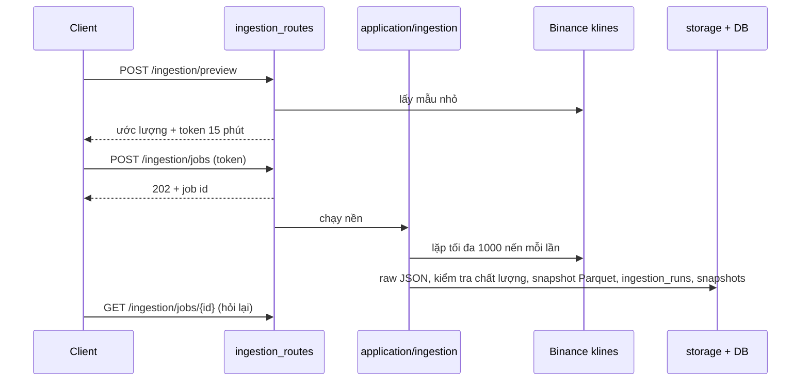
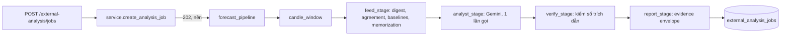

# Backend: luồng chính

## 1. Ingestion (lấy nến Binance)

- Token xem trước gắn với đầu vào (symbol, timeframe, khoảng thời gian), hết hạn sau 15 phút, giữ trong bộ nhớ tiến trình.
- Trạng thái job ingestion giữ trong bộ nhớ (`_jobs`), mất khi restart server.
- Bỏ nến ngoài khoảng và nến chưa đóng; kiểm tra thiếu, trùng, lệch giờ; id snapshot là SHA-256 của nội dung.
- Lỗi Binance: timeout thì thử lại; `429` báo giới hạn; `418` dừng ngay.
- CLI tương đương: `fetch-pilot`, `fetch-history`.

## 2. Replay (mô phỏng chiến thuật offline)

- `POST /replay/jobs` nhận `snapshot_id`, `buy_time_ms`, `buy_price`, `horizon_minutes` (mặc định 30); chỉ dùng nến `available_at <= t`.
- `POST /replay/jobs/{id}/vote` rồi `/reveal`: người dùng vote trước khi mở kết quả; vote không sửa lại.
- Engine chấm `strategy_evaluation` (`entry_strategy`, `barrier_evaluation`). `ai_prediction.predicted_direction` là `NO_MODEL`: hướng AI chỉ đến từ báo cáo Gemini.
- Mỗi job lưu thành file JSON trong `data/simulations/`, nạp lại khi khởi động. Không có bảng DB cho replay.
- Đường dẫn file snapshot được phân giải qua `resolve_snapshot_file_path` (cwd, gốc repo, `backend/`); không thấy file thì trả `404`.

## 3. Báo cáo Gemini (`external_analysis/`)

- Mặc định `forecast-6h-v1`: horizon 360 phút, lookback 14 ngày, đầu ra UP hoặc DOWN, không grounding, không research agent. Confidence tự khai không phải xác suất đã hiệu chỉnh.
- Trạng thái dùng: `PREPARING_FEED`, `ANALYZING`, `READY`, `INSUFFICIENT_HISTORY`, `FAILED`, `FAILED_INTERRUPTED`. Enum `AnalysisStatus` còn các giá trị cũ (`RESEARCHING`, `MATCHING`, `SYNTHESIZING`, `ABSTAIN`...) chưa dùng trong luồng 6h.
- Khi khởi động, lifespan chuyển job đang dở sang `FAILED_INTERRUPTED`; không tự gọi lại API có phí.
- `vote` rồi `reveal`: outcome lấy close của nến chứa `t + horizon`; biến động tuyệt đối dưới 0.5% là `FLAT`; thiếu nến là `UNSCORABLE`.
- `GET /external-analysis/scoreboard` và CLI `forecast-batch` so Gemini với hai baseline (`always_up`, `momentum_6h`) trên cùng tập đủ dữ liệu; `--dry-run` chỉ tính baseline, không gọi Gemini.
- Hồi cứu có nguy cơ model ghi nhớ dữ liệu; cờ `possible_memorization` không chứng minh an toàn.
- Gate: [04-api-catalog.md](04-api-catalog.md) mục gate admin.

## 4. Trade watch và kế hoạch

- `trade_watch.py`, `entry_strategy.py`, `barrier_evaluation.py`, `domain/trade_plan.py`; route ở `trade_plan_routes.py`; CLI `watch-entry`.
- Lưu ở `trade_watches`, `candidate_plans`, `trade_observations`.
- Frontend chưa có trang dùng nhóm này; chưa được coi là chức năng nghiệm thu (xem `AGENTS.md`).

## 5. Quan hệ giữa replay và báo cáo

Hai job độc lập, hai nơi lưu. Frontend (`use-replay-session.ts`) cho chọn engine `strategy` hoặc `gemini`, rồi thêm engine còn lại tại cùng mốc; vote và reveal gửi cho job nào tồn tại. Chưa hợp nhất thành một job.
